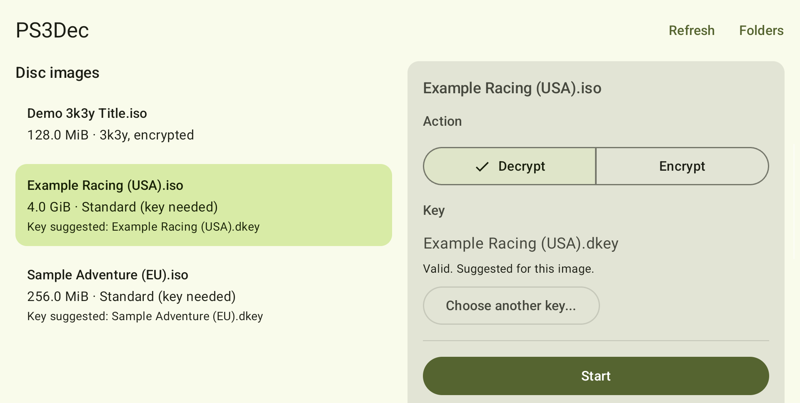
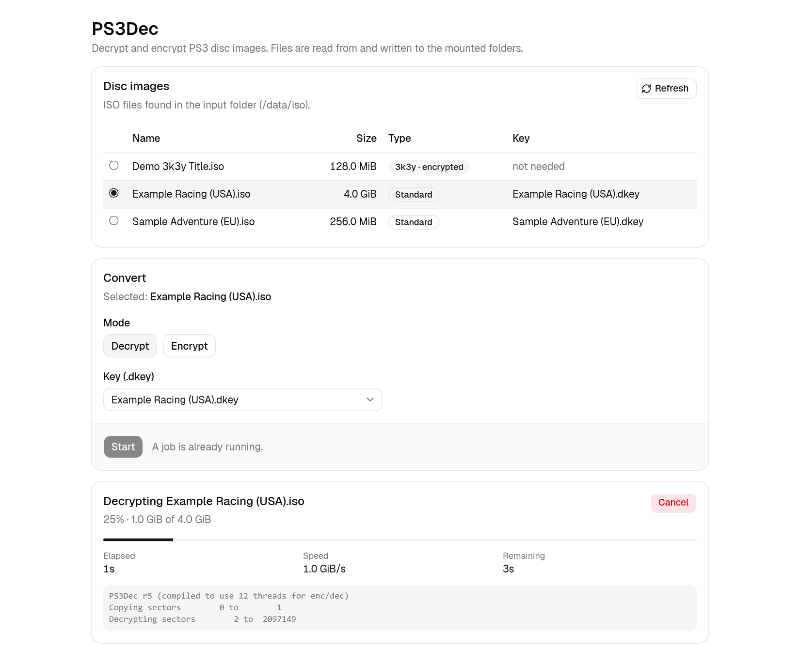
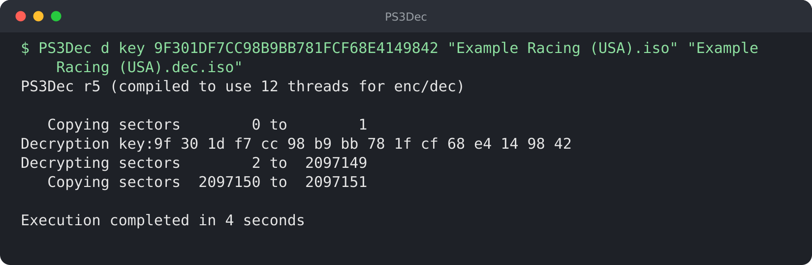

<div align="center">

# PS3Dec

**Decrypt and re-encrypt PS3 disc images — on your desktop, your server or your handheld.**

[](https://github.com/tonyp7/PS3Dec/releases/latest)
[](LICENSE)
[](https://github.com/tonyp7/PS3Dec/pkgs/container/ps3dec)

[Android app](#android-app) · [Web UI](#web-ui-docker) · [Command line](#command-line) · [Get started](#get-started) · [Technical details](#technical-details)

</div>

---

PS3Dec is a universal PS3 disc image decryptor and encryptor. It runs on Android, on Linux (as a Flatpak or natively) and in Docker.
Pick an image, pick its key, press **Start**. Everything stays on your own machine.

## Why PS3Dec

- **Modernized.** The original PS3Dec is about ten years old and no longer compiles easily on modern systems. This version updates the C code to build with current tools and ships as a Flatpak and a Docker image, so you can use it without setting up a compiler.
- **Android.** PS3 emulation on Android, with emulators such as ARMSX3, is making giant leaps, so being able to decrypt images natively on the device itself is a very useful utility.
- **Universal.** The Docker image makes PS3Dec run on pretty much anything.

## Choose your way

### Android app

<p align="center">
  
</p>

A native app built for handhelds and phones. Pick your three folders once with the system folder picker (no broad storage permission), then convert: the job keeps running with the screen off, and the whole interface can be driven from a gamepad.

### Web UI (Docker)

<p align="center">
  
</p>

One container, one page. Choose an image, accept the key it suggests, and watch live progress. The browser never uploads or downloads the images; it works on folders you mount into the container.

### Command line

<p align="center">
  
</p>

The original multi-threaded tool, built on mbedTLS 4. Use it from the container, as a Flatpak, or compile it natively on Linux, macOS or Windows.

## Get started

**Android.** Download `PS3Dec-X.Y.Z.apk` from the [latest release](https://github.com/tonyp7/PS3Dec/releases/latest) and install it (Android asks you to allow installs from your browser or file manager the first time). Each release lists the APK's SHA-256 and signing certificate.

**Web UI.** No build needed; the image is published on GHCR:

```sh
mkdir -p iso keys output          # put .iso files in ./iso and their .dkey files in ./keys
docker run --rm -p 127.0.0.1:8000:8000 --user "$(id -u):$(id -g)" \
  -v "$PWD/iso:/data/iso:ro" -v "$PWD/keys:/data/keys:ro" -v "$PWD/output:/data/output" \
  ghcr.io/tonyp7/ps3dec:latest
```

Then open <http://localhost:8000>. Converted images appear in `./output`.

**Command line.**

```sh
# Command line within Docker
docker run --rm --user "$(id -u):$(id -g)" \
  -v "$PWD/iso:/data/iso:ro" -v "$PWD/output:/data/output" \
  --entrypoint ps3dec ghcr.io/tonyp7/ps3dec:latest \
  d key <disc_key_hex> /data/iso/disc.iso /data/output/disc.dec.iso

# with the Flatpak bundle from the latest release
flatpak install PS3Dec.flatpak
flatpak run io.github.tonyp7.PS3Dec d key <disc_key_hex> disc.iso disc.dec.iso
```

## Keys in one minute

- A `.dkey` file holds the disc's key as 32 hex characters. PS3Dec uses it as is.
- A key is suggested automatically when its name matches the image's: `Game.iso` and `Game.dkey`. You can always pick another one.
- 3k3y images carry their own key and need none.
- **PS3Dec cannot tell whether a key is wrong.** With the wrong key a job still finishes "successfully" and writes an image whose encrypted parts are garbage. If the result does not boot or mount, check the key first.

---

## Technical details

Everything below is reference material for people who want to run, configure, build or hack on PS3Dec.

### Web UI

A small local web UI around the PS3Dec tool: pick a disc image and its key, press Start, watch progress. It runs in one container (FastAPI backend serving a React frontend) and works on folders you mount into it. Nothing is uploaded or downloaded through the browser.

**Local use only.** There is no authentication and one job runs at a time. Keep the port bound to `127.0.0.1` and do not expose it to a network.

#### Docker Compose and building the image yourself

```sh
mkdir -p iso keys output          # put .iso files in ./iso and their .dkey files in ./keys
docker compose up -d --build
```

Without compose:

```sh
docker build -t ps3dec .
docker run --rm -p 127.0.0.1:8000:8000 --user "$(id -u):$(id -g)" \
  -v "$PWD/iso:/data/iso:ro" -v "$PWD/keys:/data/keys:ro" -v "$PWD/output:/data/output" \
  ps3dec
```

Create the three folders first: if a bind-mounted folder is missing, Docker creates it as root and the container cannot write to it (the compose file refuses to start instead). `--user` (or `PS3DEC_UID` / `PS3DEC_GID` for compose) makes the files in `./output` yours; the image itself runs as UID 1000.

### Running the CLI inside the container

Since the PS3Dec binary is compiled inside the container, it can also be run manually in a running one, e.g.:

```sh
docker compose exec ps3dec ps3dec d key <disc_key_hex> /data/iso/disc.iso /data/output/disc.dec.iso
```

With a raw D1 value instead of a disc key, use the `d1` type, which first converts the D1 into the disc key:

```sh
docker run --rm --user "$(id -u):$(id -g)" \
  -v "$PWD/iso:/data/iso:ro" -v "$PWD/keys:/data/keys:ro" -v "$PWD/output:/data/output" \
  --entrypoint ps3dec ps3dec \
  d d1 <d1_hex> /data/iso/disc.iso /data/output/disc.dec.iso
```

### Folders

| Container path | Purpose | Mount |
|---|---|---|
| `/data/iso` | input `.iso` files (top level only, no subfolders) | read-only |
| `/data/keys` | `.dkey` files | read-only |
| `/data/output` | results | read-write |

An existing file in output is only replaced after you confirm, and only once the new one is complete (the tool writes to `<name>.iso.ps3dec.part` and renames it on success; stale `.ps3dec.part` files are removed at startup).

### Keys in detail

- A `.dkey` file holds the disc's **disc key** as 32 hex characters (an optional `0x` prefix and surrounding whitespace are fine), as distributed by redump. It is used as is, exactly like `PS3Dec d key <hex>`; it is not a D1 (`d1` is the CLI type for the raw value that the tool first converts into the disc key).
- A key is suggested for an ISO when the names match apart from the extension, ignoring case: `Game.iso` + `game.dkey`. You can pick another key by hand.
- 3k3y images carry their own key and need none.
- **The tool cannot tell whether a key is wrong.** With the wrong key a job still finishes "successfully" and writes an image whose encrypted regions are garbage. Check the key if the result does not boot or mount.

### Configuration

All optional; the defaults match the container layout above.

| Variable | Default | |
|---|---|---|
| `PORT` | `8000` | port inside the container |
| `PS3DEC_ISO_DIR` | `/data/iso` | |
| `PS3DEC_KEYS_DIR` | `/data/keys` | |
| `PS3DEC_OUTPUT_DIR` | `/data/output` | |
| `PS3DEC_BIN` | `/usr/local/bin/ps3dec` | the PS3Dec binary |
| `PS3DEC_STATIC_DIR` | `/app/static` | built frontend |

Job state is held in memory, so the app must run as a **single worker** (the default `python -m app` does; do not start it with several).

### Container image and releases

Every push to `main` builds the image and publishes it to GHCR as `ghcr.io/tonyp7/ps3dec:latest`, so it can be pulled instead of built locally:

```sh
docker pull ghcr.io/tonyp7/ps3dec:latest
```

Tagging a commit `vX.Y.Z` (always done against `main`'s current HEAD) promotes that same image to `ghcr.io/tonyp7/ps3dec:X.Y.Z` and creates a GitHub Release for that version containing that image tag, the [Flatpak bundle](#flatpak) and the signed Android APK `PS3Dec-X.Y.Z.apk` - so a release always has one container image, one Flatpak bundle and one APK at the same version. If any of them fails to build, the release is not created. The APK's SHA-256 and signing certificate are in the release notes; how releases are signed is in [android/README.md](android/README.md#releases-and-signing).

#### How the image is built

Four stages, all on Debian trixie: mbedTLS 4.2.0 is built from its release tarball and linked statically into PS3Dec; the frontend is built with Node and pnpm; the backend's Python dependencies are installed into a venv; the final stage contains only Python, `libgomp`, the venv, the binary and the built frontend, with no compilers or Node.

### Android app

A native app (Jetpack Compose) with the same flow as the web UI: pick an image, a key and a mode, press Start, follow progress. Folders are chosen with the system folder picker on first launch (no broad storage permission), the conversion runs in a foreground service so it keeps going with the screen off, and the whole interface can be operated from a gamepad. The conversion engine is written in Kotlin and is tested to produce output identical to the C tool. See [android/README.md](android/README.md) for requirements, building, installing, signing and test results on real hardware.

### Flatpak

On Linux, the CLI binary is also distributed as a Flatpak bundle, so it can be installed without a compiler or mbedTLS and runs out of the box:

1. Download `PS3Dec.flatpak` from the [latest release](https://github.com/tonyp7/PS3Dec/releases/latest).
2. `flatpak install PS3Dec.flatpak`
3. `flatpak run io.github.tonyp7.PS3Dec d key <key_hex> in.iso out.iso`

The app is granted `--filesystem=host`, meaning it can read and write anywhere on your filesystem, the same as the natively compiled binary. This is required so it can reach disc images and key files wherever you keep them.

### Building from source

#### Dependencies

**Windows**
- Visual Studio 2017 (with Visual Studio C++ tools for CMake installed)
- mbedTLS 4.x (e.g. via [vcpkg](https://vcpkg.io): `vcpkg install mbedtls`); pass the vcpkg toolchain file to CMake so it can be found

**\*nix**
- A compiler with OpenMP support
- CMake
- [Ninja](https://ninja-build.org/) (optional)
- mbedTLS 4.x (e.g. `pacman -S mbedtls`)

On macOS, libomp and mbedtls must be installed (available in Homebrew).

#### Compilation

**Windows**
1. `git clone https://github.com/tonyp7/PS3Dec`
2. In Visual Studio: Select `File > Open > CMake...` and open PS3Dec/CMakeLists.txt
3. Change the current configuration to `x64-Release`
4. Select `Build > Build Current Document (CMakeLists.txt)`
5. Select `CMake > Cache > Open Cache Folder (x64-Release Only) > PS3Dec`
6. Run the PS3Dec binary (`RelWithDebInfo\PS3Dec.exe`)

**\*nix**
1. `git clone https://github.com/tonyp7/PS3Dec && cd PS3Dec`
2. `mkdir build && cd build`
3. `cmake -G Ninja .. && ninja` if Ninja is installed; otherwise, `cmake .. && make`
4. Run the PS3Dec binary (`Release/PS3Dec`)

### Development

```sh
# backend (needs uv); the tests use build/Release/PS3Dec when it exists (see Building from source)
cd backend && uv sync && uv run pytest
PS3DEC_ISO_DIR=../iso PS3DEC_KEYS_DIR=../keys PS3DEC_OUTPUT_DIR=../output \
  PS3DEC_BIN=../build/Release/PS3Dec PS3DEC_STATIC_DIR=/nonexistent uv run python -m app

# frontend (needs pnpm); the dev server proxies /api to localhost:8000
cd frontend && pnpm install && pnpm dev
pnpm test
```

## Credits and license

PS3Dec started from the modified version of [PS3Dec r5](https://github.com/al3xtjames/PS3Dec). This version uses mbedTLS 4.x (via the PSA Crypto API) for AES encryption and decryption and CMake as the build system, and adds the container, the web UI, the Flatpak and the Android app. It exists because there are many GUI tools on Windows but not many on Linux, and a container avoids the headache of compiling a tool that needs very outdated dependencies.

Released into the public domain under [The Unlicense](LICENSE), in the spirit of the original PS3Dec code.
